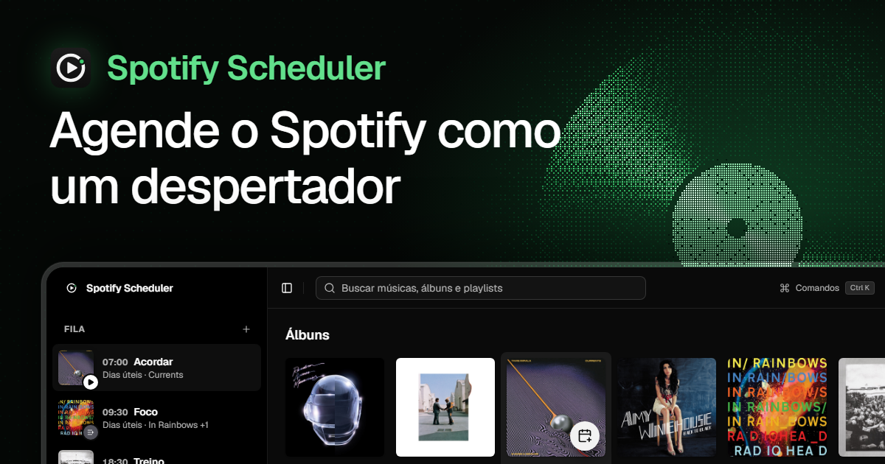

<p align="center">
  
</p>

<p align="center">
  
  
  
  
  
</p>

# Spotify Scheduler

Um despertador para o Spotify. O app fica na bandeja do Windows e, nos dias e horários que você definir, toca uma playlist, um álbum ou uma música, ou a coloca na fila. Funciona mesmo com a janela fechada.

O Spotify sozinho não agenda reprodução. Configure uma vez, a rotina de acordar, focar, treinar e dormir passa a tocar sozinha, e você não precisa mexer em nada na hora.

## Funcionalidades

- **Fila de agendamentos**: nome, horário, dias da semana, itens (playlists, álbuns e músicas) e shuffle
- **Dois modos**: _Tocar_ começa a reproduzir o item na hora, _Enfileirar_ adiciona as músicas ao fim da fila atual (até 100 por disparo)
- **Busca no Spotify** para achar músicas, álbuns e playlists e criar um agendamento a partir do resultado, ou adicionar o item a um existente
- **Testar agora**: dispara um agendamento na hora para conferir se está certo
- **Roda em segundo plano**: fecha a janela, o agendador continua na bandeja
- **Tolerância ao suspender**: se o PC acordar até 2 minutos depois do horário, o agendamento ainda dispara
- **Notificações** do Windows quando um agendamento dispara, com sucesso ou erro
- **Atalhos**: `Ctrl+N` novo agendamento, `Ctrl+K` paleta de comandos, `Ctrl+B` recolhe a fila
- Tema claro e escuro, interface em português do Brasil

## Instalação

Baixe o instalador (`setup.exe` ou `.msi`) ou a versão portátil (`portable.exe`) na página de [Releases](https://github.com/Edgarcsr/spotify-scheduler/releases).

### Conectar ao Spotify

O app usa o seu próprio app do Spotify, então não depende de chaves de terceiros:

1. Abra o [dashboard de desenvolvedor do Spotify](https://developer.spotify.com/dashboard) e crie um app.
2. Em _Redirect URIs_, adicione `http://127.0.0.1:43821/callback`.
3. Copie o **Client ID**, cole no app em _Conectar Spotify_ e autorize o acesso no navegador.

A tela de conexão mostra a Redirect URI certa e abre o dashboard para você.

## Desenvolvimento

Pré-requisitos: toolchain do [Rust](https://www.rust-lang.org/tools/install), as dependências do Tauri para Windows (veja os [pré-requisitos do Tauri](https://v2.tauri.app/start/prerequisites/)) e o [Bun](https://bun.sh).

```bash
# instala as dependências
bun install

# roda só o frontend no navegador
bun run dev

# roda o app desktop
bun run tauri dev

# gera o instalador
bun run tauri build
```

## Stack

- [Tauri](https://tauri.app) v2, com backend em Rust para o agendador, as chamadas à API do Spotify e a persistência
- [React](https://react.dev) 19 + [TypeScript](https://www.typescriptlang.org)
- [Vite](https://vite.dev)
- [Tailwind CSS](https://tailwindcss.com) v4 + [shadcn/ui](https://ui.shadcn.com) + Radix UI
- [lucide-react](https://lucide.dev) e a fonte Geist

## Estrutura

```
src/           frontend React
  components/  fila, biblioteca, diálogos e primitivas do shadcn/ui
  hooks/       agendamentos, busca e status do Spotify
  lib/         tipos, regras de horário e chamadas ao backend
src-tauri/     backend Rust (Tauri v2)
  src/         scheduler, auth (OAuth PKCE), spotify, estado e comandos
assets/banner/ banner deste README (fonte em banner.src.html)
```
